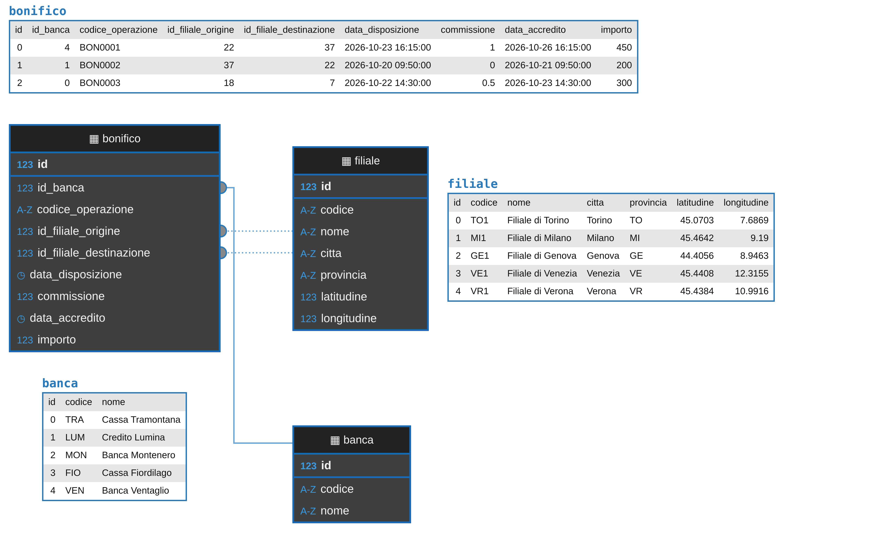
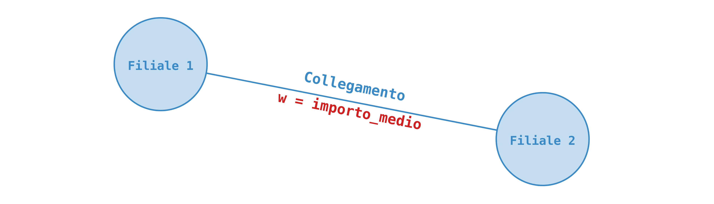
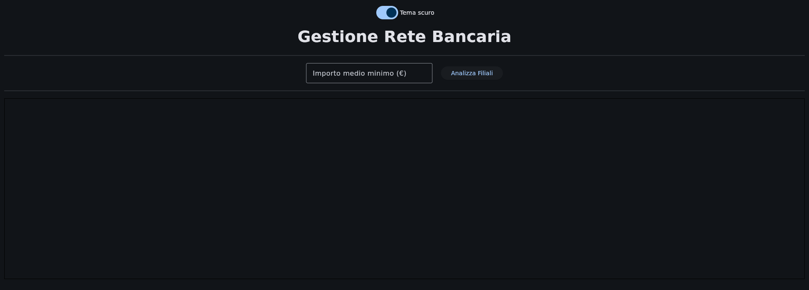
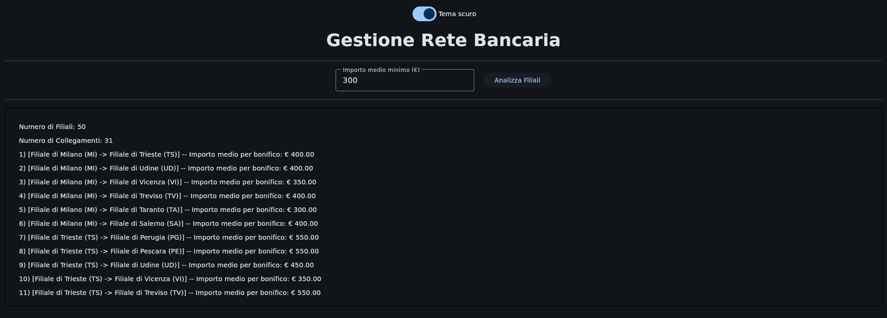

# Lab 10

#### Argomenti

- Utilizzo di Grafi
- Utilizzo della libreria [NetworkX](https://networkx.org/) (suggerita v3.5)

---
> **❗ ATTENZIONE:**
>  Ricordare di effettuare il **fork** del repository principale, quindi clonare su PyCharm il **repository personale**
> (https://github.com/my-github-username/Lab10) e non quello principale.
>
> In caso di dubbi consultare la guida caricata nel lab02:
> https://github.com/Programmazione-Avanzata-2026-27/Lab02/blob/main/Guida.pdf
>
> Per il setup del database (XAMPP, DBeaver e creazione del database tramite il file `rete_bancaria.sql`) fare riferimento alla spiegazione del Lab06.

---

##  Analisi dei collegamenti tra filiali in una rete bancaria
In questo laboratorio si richiede di sviluppare un'applicazione Python dotata di interfaccia grafica che analizzi
i collegamenti tra le diverse filiali di una rete bancaria, a partire dai bonifici effettuati tra di esse.
I dati provengono dal database fornito, denominato `rete_bancaria.sql`, che contiene le seguenti tabelle:
- `banca`: contiene le informazioni inerenti alle varie banche:
  - id
  - codice
  - nome

- `filiale`: contiene le informazioni inerenti a tutte le filiali:
  - id
  - codice
  - nome
  - citta
  - provincia
  - latitudine
  - longitudine

- `bonifico`: contiene le informazioni inerenti a tutti i bonifici effettuati:
  - id
  - id_banca
  - codice_operazione
  - id_filiale_origine
  - id_filiale_destinazione
  - data_disposizione
  - commissione
  - data_accredito
  - importo



A partire da queste informazioni, ogni **collegamento** è definito come l'insieme dei bonifici avvenuti tra
due filiali (indipendentemente dalla direzione) e ha un "valore" che corrisponde all'importo medio di
ciascun bonifico su quel collegamento, indicando quanto, in media, ogni bonifico muova economicamente su quel collegamento.

L'applicazione permette di svolgere tre compiti principali:
1. Inserire, tramite interfaccia grafica, un valore numerico espresso in euro, che farà da soglia (si veda il punto
successivo);
2. Costruire, alla pressione del pulsante "Analizza Filiali", un **grafo semplice**, **non orientato** e **pesato**,
in cui i nodi rappresentano le filiali e gli archi rappresentano i collegamenti tra esse; solo i collegamenti con valore
superiore o uguale alla soglia inserita dall'utente vengono inclusi nel grafo;
3. Mostrare il numero totale dei nodi del grafo, il numero degli archi e l'elenco di tutti i collegamenti, ciascuno
accompagnato dal rispettivo valore.

Per quanto riguarda la costruzione del grafo, ogni vertice deve rappresentare una filiale, mentre ogni arco deve
rappresentare un collegamento esistente tra una coppia di filiali. Il peso dell'arco, che corrisponde al valore del collegamento,
deve essere calcolato come l'importo medio dei bonifici effettuati in un collegamento: ciò significa sommare
l'importo (campo `importo` della tabella `bonifico`) di tutti i bonifici tra due filiali,
considerando sia la direzione `A→B` sia la direzione `B→A`, e dividere questo totale per il numero complessivo dei
bonifici per quella coppia di filiali.

Un arco può essere inserito nel grafo solo se questo valore è almeno pari o superiore alla soglia impostata dall'utente.
Si assuma inoltre che i valori economici registrati nel database siano espressi in euro.

Per realizzare quanto richiesto (il **punto 2**), sono possibili due modalità alternative:
- Creare una **query SQL che aggrega** automaticamente i bonifici nelle due direzioni e restituisce
direttamente per ciascuna coppia di filiali la somma totale degli importi e il numero di bonifici,
semplificando così la logica Python;
- Utilizzare una **query SQL più semplice**, demandando però al codice Python il compito di raggruppare i bonifici
nelle due direzioni e di calcolare successivamente il valore del collegamento.

L'intero progetto deve seguire il pattern MVC per separare interfaccia, logica e gestione degli eventi,
e utilizzare il pattern DAO per l'accesso ai dati.

##  Interfaccia
Nel progetto di base, l'interfaccia grafica (file `view.py`) è già implementata con il seguente layout:


>💡 **Esempio di Funzionamento**: L'utente inserisce un valore di 300 euro (se non viene inserito nessun valore
> l'applicazione mostra un alert) e clicca sul pulsante "Analizza Filiali" → il programma mostra il numero totale di nodi
> del grafo, il numero di collegamenti validi e la lista di collegamenti, con affianco indicato l'importo medio.


## 💡 Suggerimenti Pratici
- Tutta la documentazione della libreria `NetworkX` è disponibile al seguente link: [`networkx_documentazione`](https://networkx.org/documentation/networkx-3.5/).
- Per quanto riguarda la risoluzione del **punto 2** tramite query complessa potrebbero essere utili le funzioni
(cliccare per accedere alla documentazione):
[`LEAST()`](https://www.w3schools.com/sql/func_mysql_least.asp) e
[`GREATEST()`](https://www.w3schools.com/sql/func_mysql_greatest.asp).

## Materiale Fornito
Il repository del lab10 è organizzato con la struttura ad albero mostrata di seguito e contiene tutto il necessario per
svolgere il laboratorio:

```code
Lab10/
├── database/
│   ├── __init__.py
|   ├── connector.cnf
|   ├── DB_connect.py
│   └── dao.py (DA MODIFICARE)
│
├── model/ (AGGIUNGERE ULTERIORI CLASSI SE NECESSARIE) 
│   ├── __init__.py
│   ├── model.py (DA MODIFICARE)
│   ├── banca.py
│   ├── bonifico.py
│   ├── collegamento.py
│   └── filiale.py
│
├── UI/
│   ├── __init__.py
│   ├── alert.py
│   ├── controller.py (DA MODIFICARE)
│   └── view.py
│
├── rete_bancaria.sql (DA IMPORTARE)
├── requirements.txt
└── main.py (DA ESEGUIRE)
 ```
